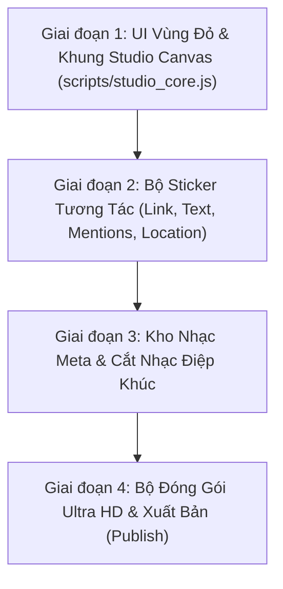

# 🎨 KẾ HOẠCH TRIỂN KHAI: INSTATWEAKS STUDIO PRO (v3.3.0)
> **Mục tiêu**: Xây dựng bộ công cụ sáng tạo & đăng tải nội dung toàn diện (Story, Post, Reel) trực tiếp trên Instagram Web từ máy tính, sở hữu đầy đủ tính năng vượt trội như INSSIST nhưng **100% Miễn phí & Không Watermark**.

> [!IMPORTANT]
> **🛡️ NGUYÊN TẮC BẤT BIẾN: BÓC TÁCH ĐỘC LẬP & BẢO TOÀN 100% CHỨC NĂNG CŨ**
> 1. **Bảo toàn các tính năng đang chạy ổn định**: Toàn bộ hệ thống cốt lõi hiện có (`Ghost Story`, `Ghost DM`, `Ghost View-Once`, `Chặn quảng cáo`, `Làm nét Video HD`, `Xem Avatar Full HD`) đã được tối ưu và chạy hoàn hảo. **Tuyệt đối không can thiệp, không sửa đổi logic nội bộ, không ghi đè làm hỏng code cũ**.
> 2. **Kiến trúc module tách biệt hoàn toàn**:
>    - **`scripts/studio_core.js`** (File mới độc lập): Đảm nhiệm toàn bộ logic xử lý Studio (Canvas kéo thả, Crop tỉ lệ, Sticker layer, Music search/trimmer, Ultra HD Transcoder, Publish engine).
>    - **`styles/studio.css`** (File mới độc lập): Chứa 100% CSS của Studio Modal, Toolbox, Sticker controls, không làm phình hay xung đột với `styles/v3_sidebar.css`.
>    - **`scripts/v3_core.js`**: Chỉ đóng vai trò kích hoạt tối giản — render cụm 3 nút tại Vùng Đỏ và phát tín hiệu mở Studio (`window.dispatchEvent(new CustomEvent('__IGT_OPEN_STUDIO__', { detail: { mode } }))`). Tuyệt đối không nhồi nhét code xử lý Studio vào file này.

---

## 📌 I. TỔNG QUAN TÍNH NĂNG & THIẾT KẾ GIAO DIỆN

### 1. Vị trí "Vùng Đỏ" trên Sidebar Drawer
Vị trí nằm ngay dưới Logo Header `INSTATWEAKS v3.2.0` và nằm phía trên mục `CHẾ ĐỘ ẨN DANH`:

```
┌────────────────────────────────────────────────────────┐
│  👾 INSTATWEAKS   v3.2.0                           ✕  │
├────────────────────────────────────────────────────────┤
│  ✨ STUDIO SÁNG TẠO & ĐĂNG BÀI                        │
│  ┌───────────────┬───────────────┬──────────────────┐  │
│  │  [Icon Story] │  [Icon Post]  │   [Icon Reel]    │  │
│  │      TIN      │   BÀI VIẾT    │    THƯỚC PHIM    │  │
│  │    (Story)    │    (Post)     │      (Reel)      │  │
│  └───────────────┴───────────────┴──────────────────┘  │
├────────────────────────────────────────────────────────┤
│  💬 CHẾ ĐỘ ẨN DANH                                     │
│  ...                                                   │
```

- **Tài nguyên Icons (Đã tích hợp vào `icons/`)**:
  - 🌟 **Tin (Story)**: `icons/studio_story.png` (Icon vòng tròn Story hồng gradient).
  - 📸 **Bài viết (Post)**: `icons/studio_post.png` (Icon điện thoại có bài đăng & nút like).
  - 🎬 **Thước phim (Reel)**: `icons/studio_reel.png` (Icon clapperboard Reels Instagram).

---

## 🛠️ II. KIẾN TRÚC KỸ THUẬT & YÊU CẦU ĐẶC TẢ

### 1. Chuẩn hóa Khung & Tỉ lệ (Aspect Ratio Engine)
Hỗ trợ đầy đủ các tỉ lệ chuẩn di động của Instagram:
* **Dọc Story & Reel (`9:16`)**: Chuẩn `1080 x 1920 px`. Nếu ảnh gốc là tỉ lệ khác, tự động sinh nền mờ nghệ thuật (Blurred Backdrop) phía sau để không méo ảnh.
* **Dọc Bảng tin Feed (`4:5`)**: Chuẩn `1080 x 1350 px` (Tối ưu diện tích màn hình lớn nhất trên điện thoại).
* **Vuông (`1:1`)**: Chuẩn `1080 x 1080 px` (Chuẩn bài viết truyền thống).
* **Ngang (`16:9` hoặc `1.91:1`)**: Chuẩn `1920 x 1080 px` (Cho video phong cảnh/ngang).
* **Tự do (Original / Gốc)**: Giữ nguyên kích thước tỉ lệ gốc của tệp tải lên.

### 2. Kéo thả vùng hiển thị (Pan & Zoom Canvas)
* Kéo thả tệp trực tiếp từ máy tính vào khung xem trước.
* Lăn chuột (Mouse Wheel) để phóng to / thu nhỏ (Zoom In / Zoom Out).
* Chuột trái giữ và kéo (Drag & Pan) để điều chỉnh góc ảnh/video đẹp nhất nằm trong khung cắt.

### 3. Tự động xuất bản ở chất lượng cao nhất (Ultra Quality Bypass)
* Tránh thuật toán nén vỡ hạt của Instagram Web bằng cách render trực tiếp ở chuẩn tối ưu:
  - **Độ phân giải**: Full HD 1080p.
  - **Color Space**: sRGB chuẩn xác, không bị xỉn màu.
  - **Video Codec**: H.264 High Profile, audio AAC 128 - 256 kbps.
  - **Bitrate**: Tối ưu ở mức 12 - 15 Mbps (Điểm cân bằng hoàn hảo để server Meta không kích hoạt bộ nén gắt).

### 4. Bộ Stickers & Công cụ tương tác (Tương đương INSSIST)
* **🔗 Link Sticker**:
  - Nhập URL đích + Tùy chỉnh nhãn chữ (ví dụ: `[🔗 MUA NGAY]`, `[🔗 XEM CHI TIẾT]`).
  - Kéo thả di chuyển sticker tự do trên màn hình Story.
* **🎵 Music Sticker & Audio Trimmer**:
  - Kết nối API lấy danh mục nhạc Meta: Trending, Dành cho bạn, Tìm kiếm ca sĩ/bài hát.
  - Thanh chọn đoạn nhạc 15s - 30s (kéo chọn điệp khúc hay nhất), nghe thử trực tiếp.
  - Dán nhãn đĩa nhạc / tên bài hát lên màn hình.
* **💬 Text Tool**: Viết chữ tùy chỉnh, đổi màu sắc, font chữ, căn lề.
* **🏷️ Mentions (@tag)**: Tag tài khoản bạn bè.
* **📍 Location Sticker**: Tìm kiếm và gắn vị trí địa lý.

---

## 🚀 III. LỘ TRÌNH TRIỂN KHAI CHI TIẾT (4 GIAI ĐOẠN)



### 📌 Giai đoạn 1: Dựng nút tại Vùng Đỏ & Khung Studio Canvas (Tỉ lệ & Kéo thả)
- [ ] Khởi tạo 2 tệp độc lập mới: `scripts/studio_core.js` và `styles/studio.css`.
- [ ] Khai báo 2 file mới trong `manifest.json` để tải song song, không phụ thuộc vào `v3_core.js`.
- [ ] Trong `scripts/v3_core.js`: Chỉ thêm mã HTML hiển thị 3 nút bấm tại Vùng Đỏ (Story, Post, Reel) kèm sự kiện phát tín hiệu `__IGT_OPEN_STUDIO__`.
- [ ] Trong `scripts/studio_core.js`: Xây dựng cấu trúc `Studio Modal` toàn màn hình với:
  - Cột trái: Khung Canvas Preview với các mốc tỉ lệ (9:16, 4:5, 1:1, 16:9, Original).
  - Cột phải: Thanh công cụ lựa chọn thuộc tính.
- [ ] Tích hợp tính năng kéo thả ảnh/video từ máy tính vào Canvas.
- [ ] Lập trình cơ chế Pan (kéo rê vị trí) và Zoom (lăn chuột phóng to/thu nhỏ) mượt mà.

### 📌 Giai đoạn 2: Bộ công cụ Sticker, Link, Text & Mention
- [ ] Xây dựng toàn bộ trong `scripts/studio_core.js`.
- [ ] Tích hợp lớp Draggable Sticker Overlay: Cho phép click và kéo thả các phần tử sticker trên bề mặt ảnh/video.
- [ ] **Tab Link**: Nhập URL + Custom Sticker Text, hỗ trợ đổi kiểu dáng (Default, Minimalist, Colorful).
- [ ] **Tab Text**: Bộ gõ văn bản đè lên ảnh/video với bảng chọn màu và cỡ chữ.
- [ ] **Tab Mentions & Location**: Ô nhập @username và gán địa điểm.

### 📌 Giai đoạn 3: Kho nhạc bản quyền Meta & Thanh cắt nhạc theo đoạn
- [ ] Xây dựng Background Handler trong `scripts/background.js` (không đụng vào logic cũ):
  - Truy vấn API danh mục Trending / For You của Instagram.
  - Thanh tìm kiếm bài hát theo tên ca sĩ / tên bài hát.
- [ ] Trong `scripts/studio_core.js`:
  - Trình phát nhạc Web Audio API nghe thử tức thì.
  - Thanh sóng âm (Waveform / Slider) kéo chọn chính xác đoạn nhạc 15s hoặc 30s.
  - Gắn nhãn Sticker âm nhạc lên khung hình.

### 📌 Giai đoạn 4: Bộ đóng gói Ultra HD & Xuất bản trực tiếp (Publish Engine)
- [ ] Xây dựng bộ Transcoder trong `scripts/studio_core.js`: Sử dụng Canvas API & MediaRecorder/WebAudio đóng gói ảnh/video + nhạc thành tệp MP4 chuẩn nén tối ưu.
- [ ] Nút **"Tải về Ultra HD"**: Cho phép tải file sạch hoàn chỉnh (không watermark) về máy tính.
- [ ] Nút **"PUBLISH"**: Kết nối với luồng upload của Instagram để đăng trực tiếp lên tài khoản.

---

## 📋 IV. DANH SÁCH FILE LIÊN QUAN & PHÂN TÁCH TRÁCH NHIỆM

| Tệp | Trạng thái | Nhiệm vụ / Trách nhiệm |
| :--- | :--- | :--- |
| `icons/studio_story.png` | **Đã tạo** | Icon Story mới |
| `icons/studio_post.png` | **Đã tạo** | Icon Post mới |
| `icons/studio_reel.png` | **Đã tạo** | Icon Reel mới |
| `scripts/studio_core.js` | **Tạo mới độc lập** | Chứa 100% logic Studio, Canvas, Tỉ lệ, Sticker, Nhạc, Render MP4 |
| `styles/studio.css` | **Tạo mới độc lập** | Chứa 100% CSS của Studio Modal, Canvas và Stickers |
| `manifest.json` | **Cập nhật khai báo** | Đăng ký nạp `styles/studio.css` và `scripts/studio_core.js` |
| `scripts/v3_core.js` | **Chỉ kích hoạt** | Chỉ render 3 nút tại Vùng Đỏ & phát sự kiện mở Studio, **giữ nguyên vẹn 100% các tính năng cũ** |
| `scripts/background.js` | **Thêm handler** | Thêm listener riêng biệt xử lý truy vấn nhạc Meta |
