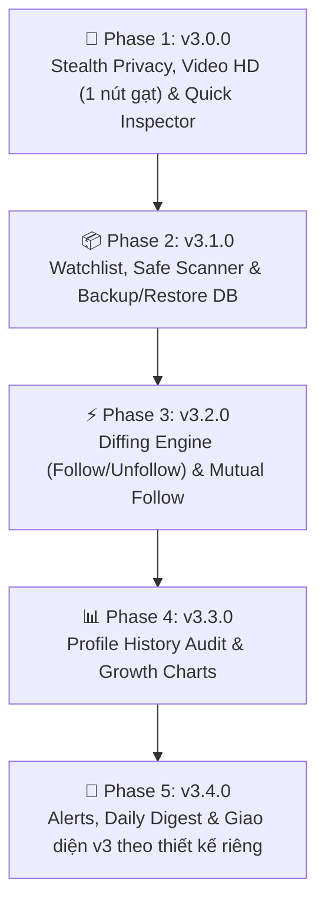

# 🎯 KẾ HOẠCH TRIỂN KHAI CHÍNH THỨC - INSTATWEAKS v3.0 (ĐÃ ĐIỀU CHỈNH)

> **Phiên bản khởi đầu**: `v3.0.0`  
> **Trạng thái**: Đã thống nhất & sẵn sàng thực hiện!  
> **Lộ trình**: 5 Phase tuần tự  

---

## 🧭 CÁC NGUYÊN TẮC THIẾT KẾ ĐÃ ĐƯỢC CHỐT
1. 🎚️ **Làm nét Video**: Giao diện chỉ có **1 nút gạt Toggle (Bật / Tắt)** duy nhất. Logic kỹ thuật (ép 1080p + SVG/CSS filter) tự động chạy ngầm.
2. 💾 **Lưu trữ IndexedDB**: Lưu cục bộ an toàn, không mất khi đóng tab; hỗ trợ sẵn **Nút Xuất Backup (.json)** và **Khôi phục (Restore)** 1 cú click.
3. 📦 **Kiến trúc v3**: Tách riêng biệt hoàn toàn với các tính năng cũ (Media Player & Tải Profile ZIP), giao diện tổng thể v3 sẽ chờ phương án thiết kế cụ thể từ bạn.

---

## 🗺️ TỔNG QUAN LỘ TRÌNH (5 PHASES)

---

## 📋 CHI TIẾT TỪNG PHIÊN BẢN

### 🟢 PHASE 1: BẢN v3.0.0 (ĐÃ HOÀN THÀNH 100% ✅)
- [x] **1. Nâng cấp Version**: Cập nhật `manifest.json` lên `version: "3.0.0"`.
- [x] **2. Nút Sidebar v3 & Drawer Panel**:
  - Nút icon con ma pixel xanh (`ghost.png`) đặt tại vị trí thanh navigation bên trái (dưới logo Instagram, trên icon Home).
  - Khi click: Mở Drawer trượt từ bên trái với tiêu đề **INSTATWEAKS v3.0**.
- [x] **3. Ghost Story Viewer**: Chặn triệt để request `POST .../stories/reel/seen/` và GraphQL `mark_seen` (xem story ẩn danh, không tăng view).
- [x] **4. Ghost DM Reader**: Chặn request báo đã đọc `direct_v2/threads/.../seen/` (đọc tin nhắn ẩn danh).
- [x] **5. Clean Feed AdBlock**: Lọc bỏ hoàn toàn các bài viết `is_sponsored: true` và Sponsored text khỏi Newfeed.
- [x] **6. Chế độ làm nét Video HD**:
  - Giao diện: 1 nút gạt Toggle bật/tắt duy nhất.
  - Ngầm: Ép luồng 1080p + Bộ lọc SVG/CSS Convolution Filter làm sắc nét viền, tăng contrast và màu sắc thời gian thực.
- [x] **7. Quick Profile Inspector**: Hiển thị User ID số thực tế, Bio links mở rộng, Website trong Drawer khi ở Profile bất kỳ.
- [x] **8. Nền tảng IndexedDB (Kèm module Export/Import Backup)**: Khởi tạo `InstaTweaksDB` lưu trữ an toàn, hỗ trợ sao lưu và khôi phục JSON 1 cú click.

---

### 🟢 PHASE 2: BẢN v3.1.0 (ĐÃ HOÀN THÀNH 100% ✅)
- [x] **1. Nâng cấp Version**: Cập nhật `manifest.json` và Header Drawer lên `v3.1.0`.
- [x] **2. Gỡ bỏ Profile Inspector**: Loại bỏ hoàn toàn khối soi User ID thừa thãi, dọn dẹp Sidebar tinh gọn, sang trọng.
- [x] **3. Nút "+ Watchlist" thông minh trên Profile Header**:
  - Tự động gắn nút `+ Watchlist` / `★ Trong Watchlist` trên Header trang cá nhân bất kỳ.
  - 1-click thêm/xem tài khoản được giám sát bí mật.
- [x] **4. Quản lý Watchlist trong Drawer**:
  - Thanh tìm kiếm nhanh theo username / họ tên.
  - Nút "👤 Quét tôi" quét trực tiếp Follower/Following của tài khoản đang đăng nhập.
  - Danh thiếp từng user trong Watchlist với số lượng follower/following, lần quét gần nhất và nút xóa nhanh.
- [x] **5. Safe Scanner Engine (Chống Checkpoint/Rate-limit)**:
  - Cào Followers & Following theo lô 50 tài khoản qua REST Web API chuẩn xác.
  - Thuật toán **Smart Delay ngẫu nhiên 2.5s - 4.5s** giữa mỗi lượt cào, kèm thanh tiến độ thời gian thực (Progress Bar & Counter).
  - Nút **Tạm dừng / Tiếp tục** và **Dừng lại & Lưu dữ liệu** an toàn bất cứ lúc nào.
  - Tự động phát hiện Rate Limit 429 và dừng khẩn cấp để bảo vệ an toàn tuyệt đối cho tài khoản.
- [x] **6. Trình xem Snapshot, Bộ lọc & Xuất File (CSV / JSON)**:
  - Xem danh sách tài khoản đã quét kèm tích xanh, chế độ riêng tư, link profile.
  - Ô tìm kiếm live mượt mà.
  - Nút **Xuất CSV (Excel)**: Kèm ký tự UTF-8 BOM chuẩn tiếng Việt không lỗi font.
  - Nút **Xuất JSON**: Chuẩn cấu trúc phục vụ lưu trữ hoặc lập trình.
- [x] **7. Lưu trữ bền vững vào IndexedDB**: Toàn bộ dữ liệu Watchlist và các bản Snapshot được lưu cục bộ an toàn trong `InstaTweaksDB`, sẵn sàng làm nguyên liệu cho **Phase 3 (Diffing Engine)**.

---

### 🟢 PHASE 3: BẢN v3.2.0 (ĐÃ HOÀN THÀNH 100% ✅)
- [x] **1. Nâng cấp Version**: Cập nhật `manifest.json`, Drawer header và Roadmap lên `v3.2.0`.
- [x] **2. Thuật toán Snapshot Diffing ($T_1$ vs $T_0$)**:
  - Đối soát 100% tài khoản giữa 2 bản quét liên tiếp (hoặc mốc cơ sở $T_0$).
  - Báo cáo phân loại chính xác:
    - 🟢 **Mới Follow (+)**: Ai mới follow tài khoản.
    - 🔴 **Vừa Unfollow (-)**: Ai vừa bỏ theo dõi (unfollow).
    - ⚪ **Ổn định (=)**: Các tài khoản giữ nguyên trạng thái.
  - Hỗ trợ cả 2 chế độ: Biến động Followers và Biến động Following (mình mới follow ai / vừa bỏ follow ai).
- [x] **3. Phân tích Tương hỗ & Follow chéo (Mutual Analysis)**:
  - ❌ **Không follow lại mình** (Not Following Back): Danh sách tài khoản user đang follow nhưng họ không follow lại.
  - 💖 **Người hâm mộ (Fans)**: Danh sách tài khoản follow user nhưng user chưa follow lại.
  - 🤝 **Bạn bè follow chéo (Mutual)**: Cả hai cùng theo dõi nhau.
- [x] **4. Phân tích Bạn chung Cross-User**:
  - Đối chiếu danh sách bạn chung (cùng follow / cùng được follow) giữa tài khoản của bạn và bất kỳ ai trong Watchlist.
- [x] **5. Trình xem & Xuất Báo cáo Nâng cao**:
  - Tích hợp 4 Tabs chuyên sâu trong Snapshot Viewer: `Followers`, `Following`, `⚡ Biến động (Diff)`, `👥 Tương hỗ (Mutual)`.
  - Bộ thẻ thống kê trực quan (Metrics Cards) màu sắc phân biệt rõ ràng.
  - Xuất file CSV chi tiết theo từng loại biến động và phân loại tương hỗ.

---

### 🛡️ PHASE 3.5: BẢN v3.2.5 - STEALTH DM PRO (ĐÃ TRIỂN KHAI ✅)
- [x] **1. Mở khóa Tin nhắn / Ảnh / Video tự hủy (Ghost View-Once & Disappearing Media) - HOÀN THIỆN 100%**:
  - Bóc tách direct CDN link phân giải cao từ payload `raven_media` / `visual_media`.
  - **Chặn toàn diện tín hiệu Seen**: Chặn triệt để request báo "Đã mở (Opened)" qua REST, GraphQL, XHR, sendBeacon và WebSocket. Người gửi không bao giờ biết bạn đã xem.
  - **Xem lại không giới hạn & Tải về**: Nút `👁️ Mở ảnh/video tự hủy (InstaTweaks)` tích hợp trực tiếp trên bong bóng chat + Modal Lightbox xem sắc nét và nút `⬇️ Tải về máy`.
- [~] **2. Chống Thu hồi Tin nhắn (Anti-Unsend Engine) - ĐÃ HỦY THEO ĐÁNH GIÁ KỸ THUẬT**:
  - *Lý do kỹ thuật*: Trên Instagram Web, Meta chỉ truyền tải nội dung tin nhắn khi người dùng đang mở trực tiếp cuộc trò chuyện (`/direct/t/...`). Khi ở ngoài Bảng tin Feed hoặc đang chat với người khác, server Meta chỉ gửi tín hiệu đếm thông báo nhị phân qua WebSocket (không chứa nội dung, không chứa ID tin nhắn). Khi tin nhắn bị thu hồi từ phía người gửi, server Meta xóa dữ liệu vĩnh viễn trên cloud. Việc cố gắng bắt qua DOM hoặc WebSocket ở background tiêu tốn tài nguyên và dễ sinh dương tính giả (false-positive).
  - *Quyết định*: Đã gỡ bỏ tính năng này khỏi dự án để đảm bảo extension chạy nhẹ, ổn định 100%, không xung đột và không hao tốn tài nguyên vô ích.
- [x] **3. Tích hợp UI Điều khiển trong Sidebar Drawer**:
  - Công tắc gạt độc lập trong `CHẾ ĐỘ ẨN DANH`:
    - `Xem 1 lần (Ghost)`: Bật/tắt mở khóa ảnh/video tự hủy không giới hạn số lần.

---

### 📊 PHASE 4: BẢN v3.3.0
- Nhật ký thay đổi User (Audit Log): Đổi avatar, username, tên hiển thị, bio.
- Phát hiện nick bị đổi tên, khóa tài khoản hoặc xóa khỏi danh sách follow.
- Biểu đồ tăng trưởng trực quan (Growth Charts) theo tuần, tháng.
- Thống kê tỷ lệ biến động ròng (Follow mới vs Unfollow theo ngày).

---

### 🔔 PHASE 5: BẢN v3.4.0 (HOÀN THIỆN)
- Hệ thống cảnh báo Chrome Desktop Notifications khi bị unfollow hoặc biến động bất thường.
- Daily Digest: Bảng tổng kết biến động trong 24 giờ qua.
- **Giao diện v3 độc lập**: Triển khai giao diện chuyên biệt theo đúng phương án thiết kế của bạn.
